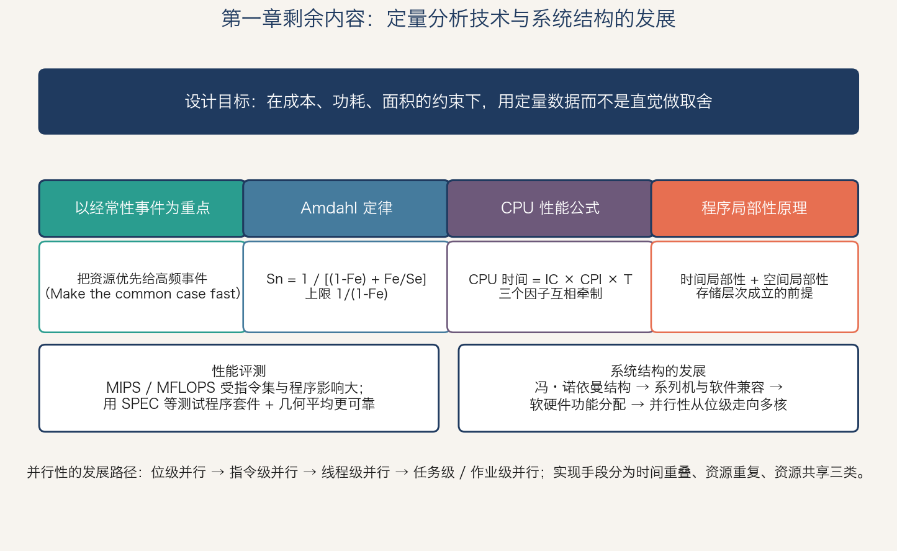
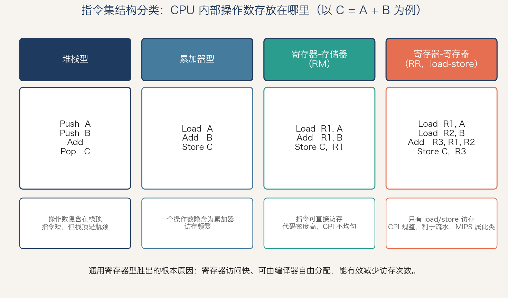
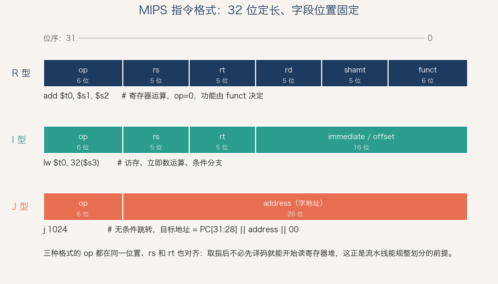
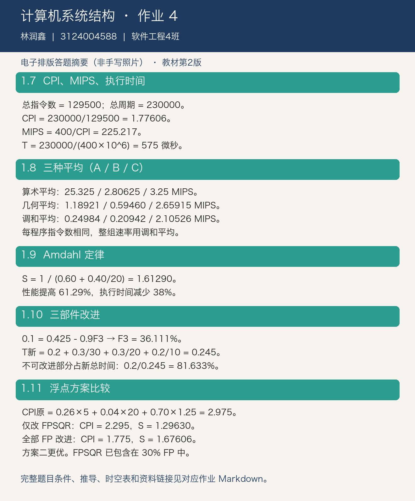

# 计算机系统结构 第四次作业

自学教材第一章剩余内容与第二章“指令系统的设计”，熟悉 MIPS 指令系统的汇编指令，并完成第一章课后习题 1.7~1.11。

## 作业信息

| | |
| -: | :- |
|科目|计算机系统结构|
|班级|软件工程4班|
|学号|3124004588|
|姓名|林润鑫|
|布置日期|2026-09-24|

## 一、自学：教材第一章剩余内容

第一章前半部分讲的是“系统结构是什么”，剩余内容讲的是“怎么定量地评价和改进它”，以及“它是如何一步步发展到今天的”。



### 1.1 定量分析技术

#### 性能的两种口径

| 口径 | 定义 | 关注者 |
| :--- | :--- | :--- |
| 响应时间（执行时间） | 从作业提交到完成所经历的时间 | 单个用户 |
| 吞吐率 | 单位时间内完成的工作量 | 数据中心、服务器管理员 |

两者并不总是同向变化：增加核数通常提高吞吐率，却不一定缩短单个程序的响应时间。

#### 四个定量原理

1. **以经常性事件为重点（Make the common case fast）。** 把硬件资源优先投给高频发生的情况。这是系统结构设计中最根本的一条，Amdahl 定律是它的量化形式。
2. **Amdahl 定律。** 对某部件改进所获得的系统加速比，受限于该部件在总执行时间中所占的比例：
   $$
   S_n=\frac{1}{(1-F_e)+\dfrac{F_e}{S_e}},\qquad S_{n,\max}=\frac{1}{1-F_e}
   $$

3. **CPU 性能公式。** 执行一个程序所需的 CPU 时间可分解为三个因子：
   $$
   \text{CPU 时间} = IC \times CPI \times T
   $$

   其中 IC 是指令条数，CPI 是每条指令的平均时钟周期数，T 是时钟周期时间。
   三个因子分别受不同层次影响，且互相牵制：

   | 因子 | 主要受什么影响 | 降低它的代价 |
   | :--- | :--- | :--- |
   | IC | 指令集结构、编译器 | 指令变复杂，CPI 可能上升 |
   | CPI | 指令集结构、微结构实现 | 流水线加深，T 下降但相关冲突变多 |
   | T | 实现工艺、流水线级数 | 主频上升导致功耗与 CPI 同时恶化 |

   当各类指令的 CPI 不同时，取加权平均：
   $$
   CPI=\sum_{i=1}^{n} CPI_i \times \frac{IC_i}{IC}
   $$

4. **程序的局部性原理。** 程序访问的存储器地址不是随机分布的，而是相对簇聚的。
   - **时间局部性**：刚被访问过的内容很可能很快再被访问（循环变量）。
   - **空间局部性**：地址相邻的内容很可能接连被访问（数组顺序遍历）。
   - 这是 Cache 与整个存储层次能够成立的前提。

#### 性能评测

| 指标 | 定义 | 局限 |
| :--- | :--- | :--- |
| MIPS | 每秒执行的百万条指令数，MIPS = f /（CPI × 10⁶） | 与指令集相关，不同 ISA 之间不可比；同一机器上不同程序的 MIPS 也不同 |
| MFLOPS | 每秒百万次浮点运算 | 只反映浮点部分；不同浮点操作的代价差异很大 |
| 测试程序套件 | SPEC CPU、TPC 等真实程序集合 | 相对可靠，但仍可能被针对性优化 |

汇总多个程序的性能时，对**执行时间比值**应取**几何平均**，而不是算术平均，否则结果会依赖参考机的选择。

### 1.2 计算机系统结构的发展

- **冯·诺依曼结构**：存储程序、指令与数据同构、顺序执行。后续所有改进基本都是在不破坏这个编程模型的前提下做的。
- **软件兼容与系列机**：同一系列的机器保持相同的系统结构，允许不同的组成与实现，从而让软件投资得到保护。由此引出**向上（下）兼容**与**向前（后）兼容**，其中**向后兼容**是系列机必须保证的。
- **软硬件功能分配**：同一功能既可以用硬件做（快、贵、不灵活），也可以用软件做（慢、便宜、灵活）。取舍依据是使用频度、实现成本与通用性。
- **推动力量**：器件工艺的进步、应用需求的牵引、算法与编程语言的演化，三者共同决定系统结构的走向。

### 1.3 并行性的发展

**并行性**指计算机系统在同一时刻或同一时间间隔内进行多种运算或操作，包括“同时性”和“并发性”。

| 角度 | 等级（由低到高） |
| :--- | :--- |
| 处理数据 | 字串位串 → 字串位并 → 字并位串 → 全并行 |
| 执行程序 | 指令内部并行 → 指令级并行 → 线程级并行 → 任务级／过程级并行 → 作业／程序级并行 |

提高并行性的三种技术途径：

| 途径 | 做法 | 例子 |
| :--- | :--- | :--- |
| 时间重叠 | 让多个处理过程在时间上错开、轮流使用同一套部件 | 流水线 |
| 资源重复 | 重复设置相同的部件 | 多核、多 ALU、阵列处理机 |
| 资源共享 | 多个用户按时间顺序轮流使用同一套资源 | 分时系统、虚拟机 |

多机系统按**耦合度**分为紧耦合（共享主存，通信延迟低）与松耦合（通过通道或网络互连，如机群）。

## 二、自学：教材第二章 指令系统的设计

指令集结构（ISA）是软硬件的分界面：**对上，它是编译器能看到的全部机器能力；对下，它决定了硬件必须实现哪些功能。**

### 2.1 指令集结构的分类

按 CPU 内部操作数的存放方式，可以分为堆栈型、累加器型和通用寄存器型，后者又细分为寄存器-存储器型（RM）与寄存器-寄存器型（RR，也叫 load-store 型）。



| 类型 | 操作数位置 | 优点 | 缺点 |
| :--- | :--- | :--- | :--- |
| 堆栈型 | 栈顶，隐含寻址 | 指令短，代码密度高 | 栈顶是瓶颈，不能随机访问，难以优化 |
| 累加器型 | 一个隐含的累加器 | 硬件简单，指令短 | 访存次数多 |
| 寄存器-存储器型（RM） | 一个在寄存器，一个可在存储器 | 代码密度高，指令条数少 | 各指令 CPI 差异大，不利于流水 |
| 寄存器-寄存器型（RR） | 全部在通用寄存器 | 指令定长、CPI 规整，便于流水和编译优化 | 指令条数多，代码密度略低 |

**通用寄存器型成为主流的原因**：寄存器访问比存储器快得多；寄存器可由编译器自由分配，能有效保存中间结果、减少访存；寄存器编号短，指令编码紧凑。MIPS 属于典型的 RR（load-store）型。

### 2.2 寻址方式

| 寻址方式 | 指令示例 | 有效地址 / 含义 |
| :--- | :--- | :--- |
| 寄存器寻址 | `add R1, R2` | 操作数在 R2 中 |
| 立即数寻址 | `addi R1, #5` | 操作数就在指令中 |
| 偏移寻址 | `lw R1, 100(R2)` | EA = 100 + Regs[R2] |
| 寄存器间接寻址 | `lw R1, (R2)` | EA = Regs[R2] |
| 索引寻址 | `lw R1, (R2 + R3)` | EA = Regs[R2] + Regs[R3] |
| 直接（绝对）寻址 | `lw R1, (1001)` | EA = 1001 |
| 存储器间接寻址 | `lw R1, @(R3)` | EA = Mem[Regs[R3]] |
| 自增／自减 | `lw R1, (R2)+` | 访问后 R2 自动加步长，适合遍历数组 |

实测统计表明，**偏移寻址、立即数寻址与寄存器间接寻址三者就覆盖了绝大多数的使用场合**，而且偏移量和立即数大多很小（多数可用 12~16 位表示）。RISC 正是据此只保留少数几种寻址方式。

### 2.3 指令集结构的功能设计：CISC 与 RISC

| 对比项 | CISC | RISC |
| :--- | :--- | :--- |
| 设计思路 | 增强指令功能，把常用操作做进硬件，缩小语义差距 | 只保留简单、常用的指令，复杂功能由指令组合完成 |
| 指令条数 | 多（数百条），长度可变 | 少（约几十条核心指令），定长 |
| 寻址方式 | 多 | 少 |
| 访存 | 多数指令可直接访存 | 只有 load / store 访存 |
| CPI | 大且不均匀 | 接近 1 且规整 |
| 实现 | 多依赖微程序控制 | 多为硬连线控制，易流水 |
| 代表 | x86、VAX | MIPS、ARM、RISC-V、LoongArch |

用 CPU 性能公式看这场争论：CISC 减小 IC，RISC 减小 CPI 和 T。实践证明后者更容易随工艺进步而扩展，所以今天即使是 x86，内部也先把复杂指令拆成类 RISC 的微操作再执行。

### 2.4 操作数的类型和大小

- 常见类型：字符（8 位）、半字（16 位）、字（32 位）、双字（64 位）、单／双精度浮点（IEEE 754）。
- **对齐要求**：地址为 s 字节的对象应放在 s 的整数倍地址上，否则需要多次访存。MIPS 要求访存对齐。
- **字节顺序**：大端（Big Endian，高位字节在低地址）与小端（Little Endian）。MIPS 两种都支持，由启动时配置决定。

### 2.5 指令格式的设计

三种常见编码方式：

| 编码方式 | 特点 | 适用 |
| :--- | :--- | :--- |
| 可变长度编码 | 指令长度随操作数个数、寻址方式而变，代码最紧凑 | 寻址方式多、追求代码密度（x86、VAX） |
| 固定长度编码 | 所有指令等长，译码简单 | 寻址方式少、追求流水效率（MIPS） |
| 混合型编码 | 提供几种固定长度，折中 | ARM Thumb-2、RISC-V 的 C 扩展 |

设计时要在**代码大小**与**译码复杂度**之间折中。流水线机器优先选固定长度，因为取指阶段不需要先译码就能知道下一条指令在哪。

### 2.6 MIPS 指令集结构



MIPS 的几条关键约定：

- 32 个 32 位通用寄存器 `$0`~`$31`，其中 `$0` 恒为 0；另有 32 个浮点寄存器。
- 指令长度固定 32 位，只有三种格式（R 型、I 型、J 型），且 op、rs、rt 字段位置完全对齐。
- 只有 load / store 访存，寻址方式只保留“寄存器 + 16 位偏移”（通过 `$0` 和立即数可模拟出直接寻址与寄存器间接寻址）。
- 访存必须按边界对齐。

## 三、熟悉 MIPS 汇编指令

### 3.1 寄存器约定

| 编号 | 名称 | 用途 |
| :-: | :--- | :--- |
| $0 | `$zero` | 恒为常数 0，写入无效 |
| $1 | `$at` | 汇编器保留（用于展开伪指令） |
| $2–$3 | `$v0–$v1` | 函数返回值、系统调用号 |
| $4–$7 | `$a0–$a3` | 函数的前四个参数 |
| $8–$15 | `$t0–$t7` | 临时寄存器，调用者保存 |
| $16–$23 | `$s0–$s7` | 保存寄存器，被调用者保存 |
| $24–$25 | `$t8–$t9` | 临时寄存器 |
| $26–$27 | `$k0–$k1` | 操作系统内核保留 |
| $28 | `$gp` | 全局指针 |
| $29 | `$sp` | 栈指针 |
| $30 | `$fp` | 帧指针 |
| $31 | `$ra` | 返回地址，由 `jal` 自动写入 |

### 3.2 常用指令

| 类别 | 指令 | 格式 | 含义 |
| :--- | :--- | :-: | :--- |
| 算术 | `add $rd,$rs,$rt` | R | rd = rs + rt（溢出产生异常） |
| 算术 | `addu / subu` | R | 无符号加减，不检查溢出 |
| 算术 | `addi $rt,$rs,imm` | I | rt = rs + 符号扩展立即数 |
| 逻辑 | `and / or / xor / nor` | R | 按位逻辑运算 |
| 逻辑 | `andi / ori` | I | 与零扩展的立即数做逻辑运算 |
| 移位 | `sll / srl / sra $rd,$rt,shamt` | R | 逻辑左移／逻辑右移／算术右移 |
| 访存 | `lw $rt, off($rs)` | I | rt = Mem[rs + off]，取一个字 |
| 访存 | `sw $rt, off($rs)` | I | Mem[rs + off] = rt |
| 访存 | `lb / lbu / sb` | I | 按字节访存，`lb` 符号扩展、`lbu` 零扩展 |
| 访存 | `lui $rt, imm` | I | 把立即数装入高 16 位，低 16 位清零 |
| 分支 | `beq / bne $rs,$rt,label` | I | 相等／不等则转移，偏移以指令为单位 |
| 比较 | `slt $rd,$rs,$rt` | R | rs < rt 则 rd = 1，否则为 0 |
| 比较 | `slti $rt,$rs,imm` | I | 与立即数比较 |
| 跳转 | `j label` | J | 无条件跳转 |
| 跳转 | `jal label` | J | 跳转并把返回地址写入 `$ra` |
| 跳转 | `jr $rs` | R | 跳到 rs 中的地址，用于函数返回 |

常用伪指令（由汇编器展开为上表中的真指令）：`li`（装入常数）、`la`（装入地址）、`move`（寄存器传送，展开为 `addu $rd,$rs,$zero`）、`blt / bgt`（展开为 `slt` + `bne`）。

### 3.3 手工编码示例

**例 1：`add $t0, $s1, $s2`（R 型）**

| 字段 | op | rs | rt | rd | shamt | funct |
| :--- | :-: | :-: | :-: | :-: | :-: | :-: |
| 十进制 | 0 | 17（`$s1`） | 18（`$s2`） | 8（`$t0`） | 0 | 32 |
| 二进制 | 000000 | 10001 | 10010 | 01000 | 00000 | 100000 |

拼接得 `0000 0010 0011 0010 0100 0000 0010 0000`，即机器码 **0x02324020**。

**例 2：`lw $t0, 32($s3)`（I 型）**

| 字段 | op | rs | rt | immediate |
| :--- | :-: | :-: | :-: | :-: |
| 十进制 | 35 | 19（`$s3`） | 8（`$t0`） | 32 |
| 二进制 | 100011 | 10011 | 01000 | 0000 0000 0010 0000 |

拼接得机器码 **0x8E680020**。

### 3.4 示例程序：数组求和

完整源文件见 [`作业4代码/sum_array.s`](作业4代码/sum_array.s)。对应的 C 代码是：

```c
int sum = 0;
for (int i = 0; i < n; i++) sum += arr[i];
```

```mips
        .data
arr:    .word   3, 1, 4, 1, 5, 9, 2, 6      # 待求和的数组，共 8 个字
n:      .word   8                           # 元素个数
msg:    .asciiz "sum = "

        .text
        .globl  main

main:
        la      $t0, arr            # $t0 = 数组基地址 &arr[0]
        lw      $t1, n              # $t1 = n，循环上界
        li      $t2, 0              # $t2 = sum = 0
        li      $t3, 0              # $t3 = i = 0

loop:
        beq     $t3, $t1, done      # if (i == n) goto done
        sll     $t4, $t3, 2         # $t4 = i << 2，字地址偏移 = i * 4
        add     $t5, $t0, $t4       # $t5 = &arr[i]
        lw      $t6, 0($t5)         # $t6 = arr[i]
        add     $t2, $t2, $t6       # sum += arr[i]
        addi    $t3, $t3, 1         # i++
        j       loop                # 回到循环头

done:
        li      $v0, 4              # syscall 4：输出字符串
        la      $a0, msg
        syscall

        li      $v0, 1              # syscall 1：输出整数
        move    $a0, $t2
        syscall

        li      $v0, 10             # syscall 10：正常退出
        syscall
```

在 MARS 中运行，输出：

```
sum = 31
```

几点和课堂内容对应的观察：

1. `sll $t4, $t3, 2` 用移位代替乘 4，说明**编译器能把高级语言的下标运算映射成最廉价的指令**。
2. 循环体内只有一条 `lw` 访存，其余全是寄存器运算——这正是 load-store 结构的特征。
3. `beq` 和 `j` 构成控制相关，在流水线中会带来分支开销，后续第三章讲延迟槽和分支预测时会回到这里。

## 四、教材第一章课后习题 1.7~1.11

> 本节按第 2 版纸质页 28–29（电子扫描件第 44–45 页）校正题号。原稿中 1.7–1.9 使用了另一套题号；以下以本节列明的题目条件为准。

### 习题 1.7：有效 CPI、MIPS 和执行时间

题意：主频 400 MHz；整数、数据传送、浮点、分支指令分别为 45000、75000、8000、1500 条，对应 CPI 分别为 1、2、4、2。

| 指令类型 | 指令数 | CPI | 总周期 |
| :--- | ---: | ---: | ---: |
| 整数 | 45000 | 1 | 45000 |
| 数据传送 | 75000 | 2 | 150000 |
| 浮点 | 8000 | 4 | 32000 |
| 分支 | 1500 | 2 | 3000 |
| 合计 | 129500 | | 230000 |

$$
CPI=\frac{230000}{129500}\approx1.77606
$$

$$
MIPS=\frac{400}{1.77606}\approx225.217
$$

$$
T=\frac{230000}{400\times10^6}=0.000575\text{ s}=575\ \mu s
$$

答案：**CPI 约 1.776，MIPS 约 225.22，执行时间 575 微秒。** 换算主频时不能把 MHz 当作 Hz。

### 习题 1.8：三台计算机的 MIPS 及三种平均

题意：每个程序执行 100000000 条指令，四个程序的执行时间如下。

| 程序 | A 时间/s | B 时间/s | C 时间/s | A/MIPS | B/MIPS | C/MIPS |
| :--- | ---: | ---: | ---: | ---: | ---: | ---: |
| 1 | 1 | 10 | 20 | 100 | 10 | 5 |
| 2 | 1000 | 100 | 20 | 0.1 | 1 | 5 |
| 3 | 500 | 1000 | 50 | 0.2 | 0.1 | 2 |
| 4 | 100 | 800 | 100 | 1 | 0.125 | 1 |

每个程序的 $MIPS=100/t$。令四个 MIPS 为 $x_i$：

$$
A=\frac{\sum x_i}{4},\quad G=(\prod x_i)^{1/4},\quad H=\frac4{\sum(1/x_i)}
$$

| 平均方式 | 计算机 A | 计算机 B | 计算机 C |
| :--- | ---: | ---: | ---: |
| 算术平均/MIPS | 25.325 | 2.80625 | 3.25 |
| 几何平均/MIPS | 1.18921 | 0.59460 | 2.65915 |
| 调和平均/MIPS | 0.24984 | 0.20942 | 2.10526 |

每个程序的指令数相同，执行整组程序的总体速率应取**调和平均**：例如 A 为 $400/1601=0.24984$ MIPS。算术平均被 A 的单个极快程序显著拉高，不能代表整组执行时间。

### 习题 1.9：Amdahl 定律

题意：某功能加快 20 倍，原来占系统运行时间的 40%。

$$
S=\frac1{(1-0.4)+0.4/20}=\frac1{0.62}\approx1.61290
$$

答案：**性能提高到原来的约 1.613 倍，即提高约 61.29%；执行时间减少 38%。**

### 习题 1.10：三个部件同时改进

题意：三个部件加速比分别为 30、20、10，所占执行时间互不重叠。

（1）$F_1=F_2=0.3$，总加速比为 10，求 $F_3$。

$$
\frac1{10}=1-0.3-0.3-F_3+\frac{0.3}{30}+\frac{0.3}{20}+\frac{F_3}{10}
=0.425-0.9F_3
$$

$$
F_3=\frac{0.325}{0.9}=\frac{13}{36}\approx36.111\%
$$

（2）$F_1,F_2,F_3$ 分别为 30%、30%、20%。归一化原执行时间为 1：

$$
T'=0.2+0.3/30+0.3/20+0.2/10=0.245
$$

不可改进部分占改进后总时间的 $0.2/0.245=40/49\approx81.633\%$。这里分母是**改进后的总时间**，不能直接答 20%。

### 习题 1.11：两种浮点改进方案

题意：FP 占全部指令的 30%，其中 FPSQR 占全部指令的 4%；普通 FP、FPSQR、其他指令的 CPI 分别为 5、20、1.25。方案一只把 FPSQR 的 CPI 降到 3；方案二把所有 FP 的 CPI 降到 3。假设指令总数与时钟周期不变。

FPSQR 已包含在 FP 中，因此普通 FP 的比例是 $30\%-4\%=26\%$。

$$
CPI_0=0.26\times5+0.04\times20+0.70\times1.25=2.975
$$

| 方案 | 改进后 CPI | 系统加速比 | 性能提高 |
| :--- | ---: | ---: | ---: |
| 只改进 FPSQR | $0.26\times5+0.04\times3+0.70\times1.25=2.295$ | $2.975/2.295=1.29630$ | 29.630% |
| 改进所有 FP | $0.30\times3+0.70\times1.25=1.775$ | $2.975/1.775=1.67606$ | 67.606% |

答案：**方案二更好**，其系统性能约为方案一的 $2.295/1.775=1.29296$ 倍。

## 五、答题稿与参考资料

各题已在上文给出条件、代入过程和结论。电子答题稿图片见下图；老师要求的本人手写照片需在纸上或手写板另行完成，不能把排版图片当作手写证据。



教材：[第 2 版课本扫描件](https://github.com/gushouchuanzhi1/2024_hust_ComputerSystemArchitecture/blob/main/计算机系统结构教程课本.pdf)，核对纸质页 28–29；[出版社第 2 版信息](https://www.tup.tsinghua.edu.cn/bookscenter/book_05056301.html)。
