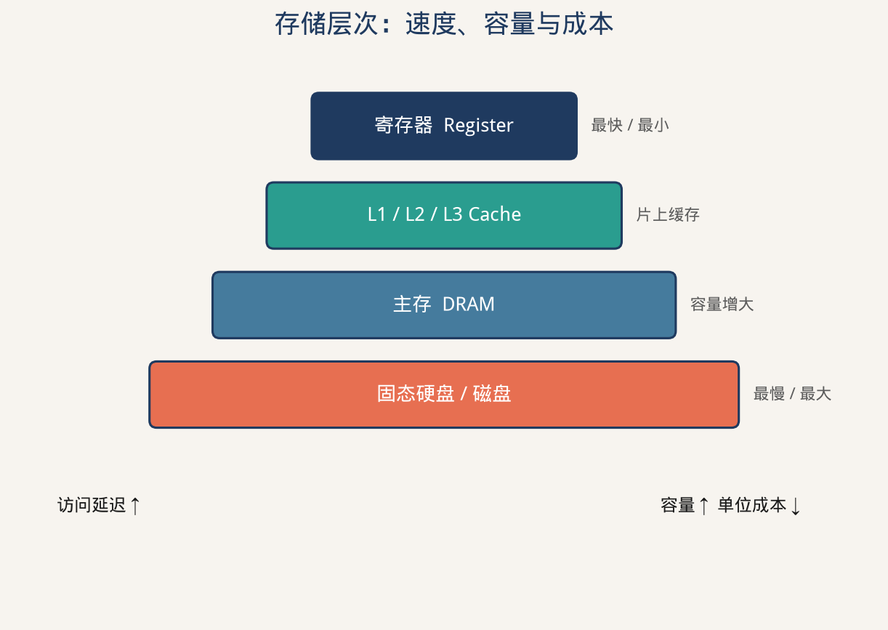
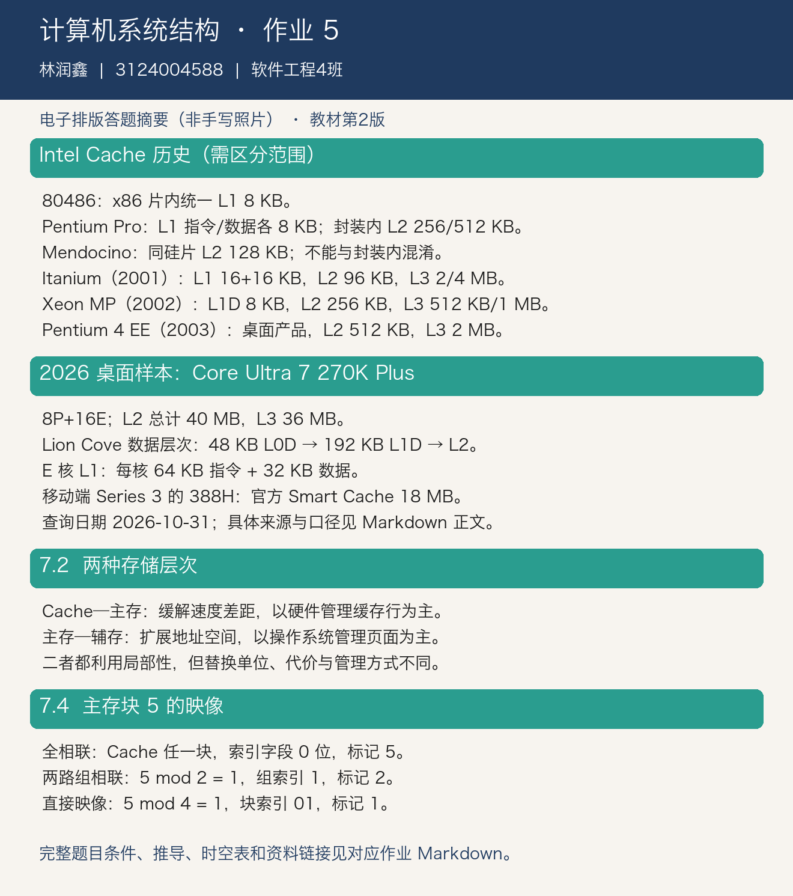

# 计算机系统结构 第五次作业

调查 Intel 处理器的 Cache 层次与容量，完成教材习题 7.2、7.4。

## 作业信息

| | |
| -: | :- |
|科目|计算机系统结构|
|班级|软件工程4班|
|学号|3124004588|
|姓名|林润鑫|
|布置日期|2026-10-08|

> 教材口径：张晨曦等《计算机系统结构教程》第 2 版，清华大学出版社，ISBN 9787302360384。根据网上可读取的课本原页核对题号；课程说明本身未指定版次。本文为电子排版解答，非手写照片。

## 一、Intel Cache 的发展



### 1.1 “开始有 Cache”应区分的口径

主板上配置 L2、同一封装内配置 L2、将 L2 集成在 CPU 同一硅片上，是三个不同概念。“Intel”还包括 x86 以外的 Itanium，不能把桌面 Pentium 的历史当作全部 Intel 产品的历史。

| 范围与里程碑 | 型号/时间 | L1 | L2 | L3 |
| :--- | :--- | :--- | :--- | :--- |
| x86 片内 L1 | 80486 / 1989 | 8 KB，指令数据统一 | 可由平台外接，容量不是 CPU 固定规格 | 无 |
| 封装内两级 Cache | Pentium Pro / 1995 | 8 KB 指令 + 8 KB 数据 | 首批 256/512 KB，同封装独立芯片 | 无 |
| 同硅片两级 Cache 的早期型号 | Celeron 300A/333（Mendocino）/1998 | 16 KB 指令 + 16 KB 数据 | 128 KB，同硅片 | 无 |
| 包含 IA-64 的三级 Cache | Itanium（Merced）/2001 | 16 KB 指令 + 16 KB 数据 | 96 KB | 2/4 MB，同封装、片外 |
| x86 同硅片三级 Cache | Xeon MP（Foster MP）/2002 | 8 KB 数据，另有指令跟踪缓存 | 256 KB | 512 KB/1 MB |
| 桌面 x86 三级 Cache | Pentium 4 Extreme Edition /2003 | 8 KB 数据 + 12K 微操作跟踪缓存 | 512 KB | 2 MB |

因此：第 1 问按常见 x86 口径答 **80486、8 KB**；第 2 问按“处理器封装中含 L1/L2”答 **Pentium Pro、8+8 KB 与 256/512 KB**，若要求同硅片，应答 Mendocino；第 3 问若不限 x86，**2001 年 Itanium 已有三级 Cache**，不能笼统地答 2003 年 Pentium 4 EE。各层容量和具体市场范围必须一起说明。

以上历史参数核对 Intel 原始手册、年报及发布公告，链接见本节末。跟踪缓存的单位是微操作数，**12K 微操作不是 12 KB**。

### 1.2 目前型号的 Cache

资料查询日期：**2026-10-31**。Intel 的桌面、移动、服务器产品各有发布时间；这里以 2026 年桌面产品 **Core Ultra 7 270K Plus（8P+16E）** 为具体样本，并列出移动端 Series 3 的情况，不把单一型号宣称为 Intel 所有产品线共同的“最新款”。

| 层次 | Core Ultra 7 270K Plus 的容量/组织 |
| :--- | :--- |
| P 核指令缓存 | 每核 64 KB；公开 CPUID 读取样本与该微架构的配置相符 |
| 最靠近核心的数据缓存 | 每个 P 核 48 KB；Intel 的 Lion Cove 微架构图将其称为 L0D |
| P 核新增数据缓存层 | 每核 192 KB，Intel 微架构图标为 L1D |
| E 核 L1 | 每核 64 KB 指令 + 32 KB 数据 |
| L2 | 总计 40 MB；8 个 P 核各 3 MB，加 4 个 E 核簇各共享 4 MB，即 $8\times3+4\times4=40$ MB |
| L3 | 36 MB Intel Smart Cache，共享末级缓存 |

容量需保留层次命名：Lion Cove 有 L0/L1/L2/L3，不能机械套用旧三层名称并把 192 KB 中间层漏掉。上表中 40 MB、36 MB 直接见 Intel 产品规格；微架构图说明每核/每簇的组织。各核私有缓存的容量之和不意味着某一个核心可以独占这全部容量。

移动端新一代 **Core Ultra X9 388H（Series 3，2026）**，Intel 官方列出 **18 MB Smart Cache**。其完整 L1/L2 拆分不在该简表中，不能把上面桌面型号的 40 MB L2 移植给它。

### 1.3 资料来源

- [Intel《i486 Microprocessor Hardware Reference Manual》§4.3](https://www.bitsavers.org/components/intel/80486/1990_i486_Microprocessor_Hardware_Reference_Manual.pdf)：8 KB 片内统一 Cache。
- [Intel Pentium Pro 原始数据手册](https://stffrdhrn.github.io/content/2019/Intel_PentiumPro.pdf)：L1 与封装内 L2。
- [Intel 1998 年年报](https://www.intc.com/filings-reports/annual-reports/content/0001047469-99-011450/0001047469-99-011450.pdf)：1998 年 8 月推出带 128 KB 片内 L2 的 Celeron 300A/333。
- [Intel《Itanium Processor Hardware Developer’s Manual》§2.5](https://people.fjfi.cvut.cz/cechmiro/Intel/itanium-hw.pdf)及[2001 年发布公告](https://www.intel.com/pressroom/archive/releases/2001/20010529comp.htm)。
- [Intel 2002 年 Xeon MP 发布公告](https://www.intel.com/pressroom/archive/releases/2002/20020312comp.htm)。
- [Intel 2003 年 Pentium 4 EE 发布公告](https://www.intel.com/pressroom/archive/releases/2003/20031103comp_a.htm)。
- [Intel Core Ultra 7 270K Plus 官方规格](https://www.intel.cn/content/www/cn/zh/products/sku/245692/intel-core-ultra-7-processor-270k-plus-36m-cache-up-to-5-50-ghz/specifications.html)。
- [Intel Lion Cove 微架构图](https://cdrdv2-public.intel.com/824430/2024_Intel_Tech%20Tour%20TW_Next%20Gen%20P-core%20The%20Lion%20Cove%20Architecture-4.pdf)及[Arrow Lake 官方架构资料](https://download.intel.com/newsroom/2024/client-computing/IFA-ARL-Press-Briefing.pdf)：缓存层次、Skymont 组织。
- [270K Plus 的公开 CPUID 实测读取样本](https://valid.x86.fr/bqgi1f)：核对每核指令/数据缓存及 L2 分组；属于具体机器的读取记录。
- [Intel 移动处理器官方对照表](https://cdrdv2-public.intel.com/843334/Intel-Core-Comparison.pdf)：Series 3、388H、18 MB Cache。

## 二、习题 7.2：两种存储层次的区别

题意：比较“Cache–主存”与“主存–辅存”两个层次。

| 比较项 | Cache–主存 | 主存–辅存 |
| :--- | :--- | :--- |
| 主要目标 | 弥补 CPU 与主存速度差距 | 扩展可用地址空间、实现虚拟存储 |
| 通常管理者 | 硬件 Cache 控制器 | 操作系统，配合 MMU 等硬件 |
| 调度单位 | Cache 块/缓存行，通常几十字节 | 页，通常数 KB 或更大 |
| 不命中处理 | 硬件从主存装入块 | 缺页异常后由操作系统调入页面 |
| 替换开销 | 相对较小 | 访问辅存，开销通常大得多 |
| 对程序的透明性 | 一般不改变程序使用的地址 | 通过虚实地址转换提供虚拟地址空间 |

共同点：都利用时间局部性与空间局部性，在容量、速度、成本之间折中；都涉及映像、替换与写策略。

## 三、习题 7.4：三种映像方式

题意：Cache 4 块、主存 8 块；比较全相联、每组两块的组相联、直接映像，并求主存块地址 5 的索引。以下块编号从 0 开始，块地址不含块内偏移。

| 主存块 | 全相联允许位置 | 两路组相联允许位置 | 直接映像位置 |
| ---: | :--- | :--- | ---: |
| 0、4 | Cache 任一块 0–3 | 组 0（块 0、1） | 块 0 |
| 1、5 | Cache 任一块 0–3 | 组 1（块 2、3） | 块 1 |
| 2、6 | Cache 任一块 0–3 | 组 0（块 0、1） | 块 2 |
| 3、7 | Cache 任一块 0–3 | 组 1（块 2、3） | 块 3 |

映像关系示意：

```text
全相联：  主存块 0..7 ──→ Cache {0,1,2,3} 中任一块
两路组相联：主存偶数块 ──→ 组0 {Cache 0,1}
            主存奇数块 ──→ 组1 {Cache 2,3}
直接映像： 主存 {0,4}→C0；{1,5}→C1；{2,6}→C2；{3,7}→C3
```

- 全相联：只有一组，**无索引字段（0 位）**，块地址 5 全部作为标记参加比较，不能说固定落在 Cache 块 1。
- 两路组相联：共有 $4/2=2$ 组，$index=5\bmod2=1$，占 1 位，标记为 $\lfloor5/2\rfloor=2$。
- 直接映像：$index=5\bmod4=1$，占 2 位（二进制 01），标记为 $\lfloor5/4\rfloor=1$。

## 四、电子答题稿



教材题目核对：[第 2 版课本](https://github.com/gushouchuanzhi1/2024_hust_ComputerSystemArchitecture/blob/main/计算机系统结构教程课本.pdf)，纸质页 240。
