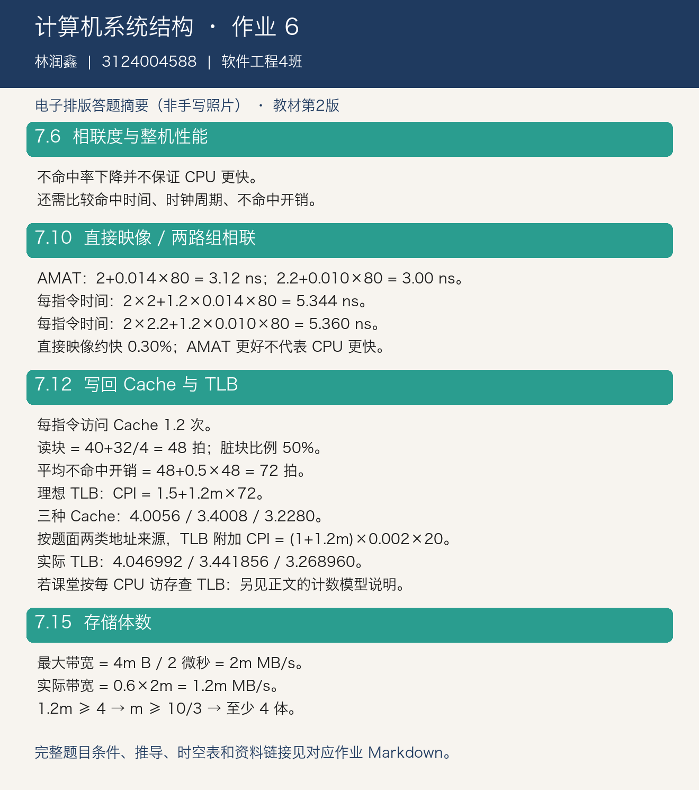

# 计算机系统结构 第六次作业

完成教材第七章习题 7.6、7.10、7.12、7.15，分析 Cache 与交叉存储器的性能。

## 作业信息

| | |
| -: | :- |
|科目|计算机系统结构|
|班级|软件工程4班|
|学号|3124004588|
|姓名|林润鑫|
|布置日期|2026-10-15|

> 教材口径：张晨曦等《计算机系统结构教程》第 2 版，清华大学出版社，ISBN 9787302360384。根据网上可读取的课本原页核对题号；课程说明本身未指定版次。本文为电子排版解答，非手写照片。

## 一、习题 7.6：相联度更高是否一定更快

题意：相同容量下，组相联 Cache 的不命中率通常比直接映像低，能否断定其性能一定更高？

**不能。** 相联度提高能减少冲突不命中，但也可能增加标记比较、多路选择的延迟，延长命中时间，甚至延长 CPU 时钟周期。必须同时比较不命中率、命中时间、不命中开销及 CPU 执行时间。

$$
AMAT=t_{hit}+m\times P_{miss}
$$

$$
T_{CPU}=IC\times CPI_{base}\times t_{clk}+N_{access}\times m\times P_{miss}
$$

其中 $P_{miss}$ 是在命中路径之外的附加不命中开销。降低不命中率只是其中一个因素，不能单凭它判断整机性能。

## 二、习题 7.10：直接映像与两路组相联

### 2.1 已知条件

| 参数 | 直接映像 | 两路组相联 |
| :--- | ---: | ---: |
| Cache 容量 | 64 KB | 64 KB |
| 块大小 | 32 B | 32 B |
| 理想 CPI | 2 | 2 |
| 时钟周期 | 2 ns | $2\times1.1=2.2$ ns |
| 平均每指令访存次数 | 1.2 | 1.2 |
| 命中时间 | 1 个本机时钟周期 | 1 个本机时钟周期 |
| 不命中率 | 1.4% | 1.0% |
| 附加不命中开销 | 80 ns | 80 ns |

### 2.2 平均访存时间

$$
AMAT_D=2+0.014\times80=3.12\text{ ns}
$$

$$
AMAT_A=2.2+0.010\times80=3.00\text{ ns}
$$

组相联的平均访存时间更短。

### 2.3 CPU 性能

平均每条指令的实际执行时间是基础执行时间加缺失停顿时间，**不能把理想 CPI 再乘完整 AMAT，以免重复计算命中时间**。

$$
T_D/IC=2\times2+1.2\times0.014\times80=5.344\text{ ns}
$$

$$
T_A/IC=2\times2.2+1.2\times0.010\times80=5.360\text{ ns}
$$

| 指标 | 直接映像 | 两路组相联 |
| :--- | ---: | ---: |
| 实际 CPI | $5.344/2=2.672$ | $5.36/2.2\approx2.43636$ |
| 指令吞吐速率/MIPS | 187.126 | 186.567 |

直接映像在此例中反而略快，性能比为 $5.36/5.344\approx1.002994$，约快 **0.30%**。这说明**更低的 CPI 或更短的 AMAT 均不必然意味着更短的 CPU 执行时间**。

## 三、习题 7.12：Cache、写回和 TLB

### 3.1 已知条件与计数约定

理想基本 CPI 为 1.5；主存延迟 40 周期，传输带宽 4 B/周期；块大小 32 B；Cache 中 50% 的块被修改；20% 指令为数据传送指令，数据访存中 25% 为写；采用写回法且无写缓冲。TLB 不命中需 20 周期，不会改变 Cache 命中率，题给 TLB 不命中比例为 0.2%。

| Cache 组织 | 不命中率 |
| :--- | ---: |
| 16 KB 直接映像混合 Cache | 2.9% |
| 16 KB 两路组相联混合 Cache | 2.2% |
| 32 KB 直接映像混合 Cache | 2.0% |

每条指令取指 1 次、数据访问平均 0.2 次，所以每条指令平均访问 Cache **1.2 次**。假设每条数据传送指令产生一次数据访问，写不命中按写分配处理。

### 3.2 理想 TLB

读取新块的时间：

$$
P_{read}=40+32/4=48\text{ cycles}
$$

被替换块有 50% 为脏块；无写缓冲时必须等待脏块写回。平均附加不命中开销：

$$
P_{miss}=48+0.5\times48=72\text{ cycles}
$$

因此：

$$
CPI_{ideal\ TLB}=1.5+1.2m\times72
$$

| Cache | 代入过程 | 实际 CPI（理想 TLB） |
| :--- | :--- | ---: |
| 16 KB 直接映像 | $1.5+1.2\times0.029\times72$ | 4.0056 |
| 16 KB 两路组相联 | $1.5+1.2\times0.022\times72$ | 3.4008 |
| 32 KB 直接映像 | $1.5+1.2\times0.020\times72$ | 3.2280 |

写回法不要求每次写命中都立即写主存，所以**不能再乘 25% 为所有写操作追加一次主存延迟**；50% 的脏块概率已经用于替换时的写回代价。

### 3.3 实际 TLB

本题原文限定为“CPU 产生指令地址或在 Cache 不命中时产生的地址有 0.2% 没有在 TLB 中找到”。按此字面口径，需计入每条指令一次指令地址翻译，以及每次 Cache 不命中产生的地址翻译：

$$
N_{TLB}=1+1.2m
$$

脏块回写使用缓存中保存的物理块地址，不额外产生一次虚实地址翻译。于是：

$$
\Delta CPI_{TLB}=(1+1.2m)\times0.002\times20
$$

| Cache | TLB 附加 CPI | 实际 CPI |
| :--- | ---: | ---: |
| 16 KB 直接映像 | 0.041392 | **4.046992** |
| 16 KB 两路组相联 | 0.041056 | **3.441856** |
| 32 KB 直接映像 | 0.040960 | **3.268960** |

若课堂将题意简化为“每一次 CPU 访存均访问 TLB，不额外计 Cache 缺失地址”，则用 $1.2\times0.002\times20=0.048$ 作为附加 CPI，三者分别为 **4.0536、3.4488、3.2760**。这两组结果对应不同的 TLB 访问计数模型；本文主答案采用题目原文列出的两类地址来源，不能混用计数口径。

## 四、习题 7.15：低位交叉存储器的体数

题意：每个存储体的存储周期为 2 微秒，字长 4 B，采用 $m$ 个存储体低位交叉编址；实际带宽为最大带宽的 0.6 倍，要求实际带宽达到 4 MB/s。

$$
B_{max}=\frac{4m\text{ B}}{2\ \mu s}=2m\text{ MB/s}
$$

$$
B_{actual}=0.6B_{max}=1.2m\text{ MB/s}
$$

$$
1.2m\ge4\quad\Rightarrow\quad m\ge\frac{10}{3}
$$

答案：存储体数取整数，**至少 4 体**。此时理论带宽 8 MB/s，实际带宽 4.8 MB/s，达到要求。若要求体数为 2 的幂，最小值也仍为 4。

## 五、电子答题稿

教材题目核对：[第 2 版课本](https://github.com/gushouchuanzhi1/2024_hust_ComputerSystemArchitecture/blob/main/计算机系统结构教程课本.pdf)，纸质页 241–242。
