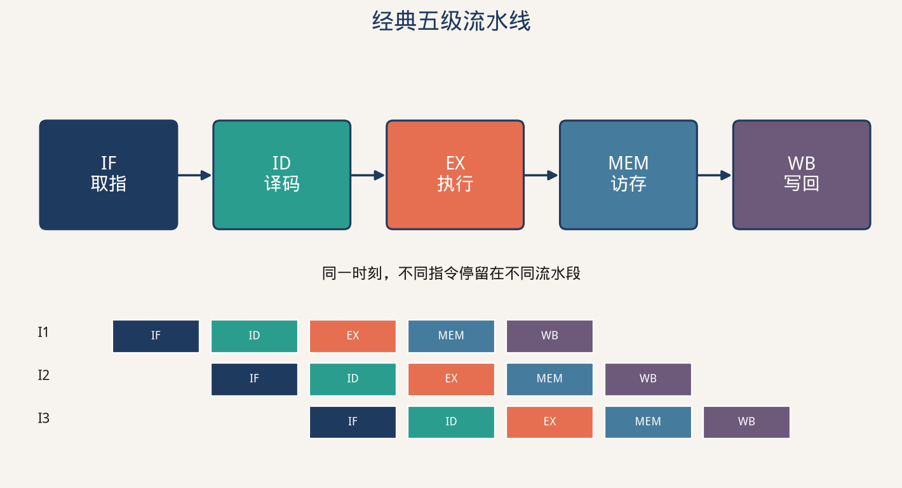
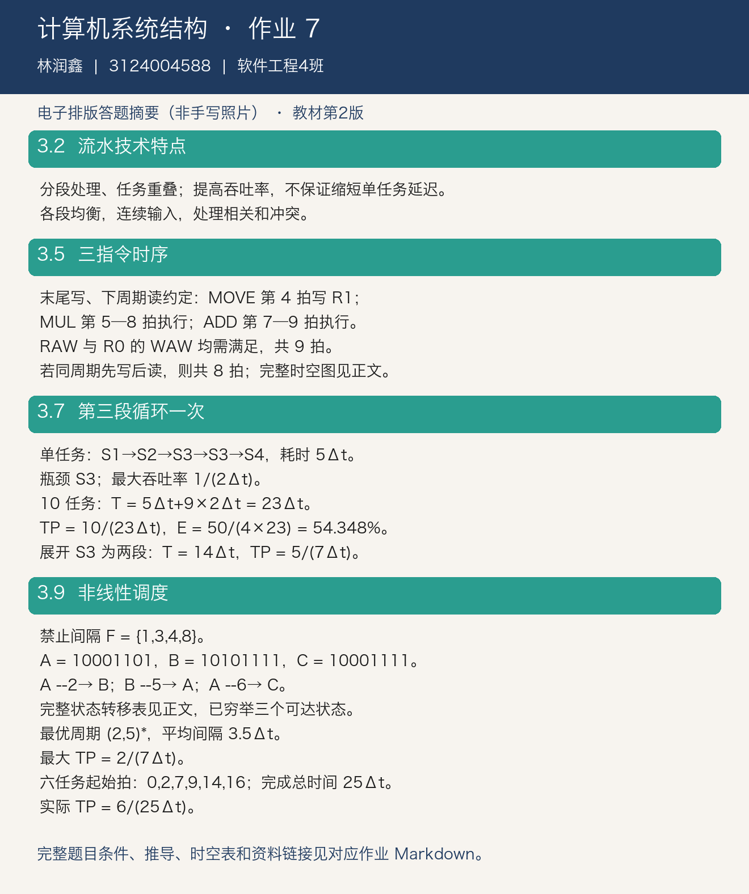

# 计算机系统结构 第七次作业

调查 Intel、龙芯、华为 CPU 的流水线相关数据，完成教材习题 3.2、3.5、3.7、3.9。

## 作业信息

| | |
| -: | :- |
|科目|计算机系统结构|
|班级|软件工程4班|
|学号|3124004588|
|姓名|林润鑫|
|布置日期|2026-10-22|

> 教材口径：张晨曦等《计算机系统结构教程》第 2 版，清华大学出版社，ISBN 9787302360384。根据网上可读取的课本原页核对题号；课程说明本身未指定版次。本文为电子排版解答，非手写照片。

## 一、CPU 流水线资料调查



### 1.1 典型型号及公开参数

| 厂商与型号 | 流水线相关数据 | 含义与范围 |
| :--- | :--- | :--- |
| Intel Pentium III | Intel 公告按 10 级描述 | 同一公告中用于对比 Pentium 4 的管线深度 |
| Intel Pentium 4（初代 NetBurst） | 20 级流水线 | 这是初代型号口径，不能推广到所有 Pentium 4 后续核心 |
| 龙芯 3A5000 / LA464 | 四发射乱序；4 个定点、2 个向量、2 个访存单元 | 发射宽度与执行部件数，不是流水级数 |
| 龙芯 3A6000 / LA664 | 六发射乱序；4 个定点、4 个向量、4 个访存单元；每核支持两线程 | 增宽执行资源并支持 SMT；不能因此称为“六级流水线” |
| 华为鲲鹏 920 | 官方编程指南描述为八级流水线、八个执行管道，采用乱序发射 | 级数是纵向阶段数，执行管道数是横向功能通路数，二者不是同一个量 |

龙芯两款产品的引用页未给出一个明确、统一的完整流水深度，因此此处只列厂商可核实的发射宽度与执行部件数，不补写未经证实的级数。

### 1.2 从数据得到的认识

1. **深度与宽度不同。** 20 级是把指令处理过程分成较多阶段；六发射是一个周期可发射多条指令。
2. **流水线深不保证整机快。** 划分更多阶段可以缩短时钟周期，但也增加流水寄存器开销与分支预测失败的恢复成本。
3. **乱序执行与按序提交配合。** 无数据依赖的指令可越过等待指令执行，而提交阶段保证体系结构状态和精确异常。
4. **多核、SMT、超标量不同。** 多核增加独立核心；SMT 让多个线程共享一个核心；超标量在同一核心中并行处理多条指令。

资料来源（查询日期 2026-10-31）：

- [Intel 2000 年 Pentium 4 官方发布公告](https://www.intel.com/pressroom/archive/releases/2000/dp112000.htm)：Pentium III 10 级与 Pentium 4 20 级的对比。
- [龙芯 3A5000 官方产品页](https://loongson.cn/index.php/product/show?id=10)。
- [龙芯 3A6000 官方产品页](https://www.loongson.cn/product/show?id=26)及[处理器数据手册](https://www.loongson.cn/uploads/images/2025020509235656912.Loongson3A6000%20data%20book_V1.3.pdf)。
- [华为鲲鹏社区：鲲鹏流水线](https://www.hikunpeng.com/document/detail/zh/perftuning/progtuneg/kunpengprogramming_05_0009.html)。该指南的八级抽象描述不意味着每种复杂指令均能一周期完成。

## 二、习题 3.2：流水技术的特点

流水技术把一个处理过程拆成多个子过程，每个子过程由专门的功能段完成。连续输入多个任务后，不同任务可在不同功能段重叠执行。

- **提高吞吐率**：充分重叠时，每隔一个流水节拍就可完成一个任务。
- **不等于缩短单个任务的延迟**：一个任务仍须经历所有阶段，且有流水寄存器开销。
- **各段时间应尽量均衡**：最慢段决定节拍，不均衡会造成其他段空闲。
- **需要连续任务流**：建立与排空过程降低短任务序列的效率。
- **相关与冲突会产生停顿**：需要旁路、互锁、调度、预测等机制维持正确性。

等长 $k$ 段、每段时间 $\Delta t$，连续处理 $n$ 个独立任务时：

$$
T=(k+n-1)\Delta t,\quad TP=\frac n{(k+n-1)\Delta t},\quad S=\frac{nk}{k+n-1},\quad E=\frac n{k+n-1}
$$

## 三、习题 3.5：三条指令的时空图

题意：取指和译码各 1 周期，MOVE、ADD、MUL 操作分别需 2、3、4 周期；操作的首周期读寄存器，末周期写寄存器。

```text
MOVE R1,R0       ; R1 ← R0
MUL  R0,R2,R1    ; R0 ← R2 × R1
ADD  R0,R3,R2    ; R0 ← R3 + R2
```

以指令的首操作数为目的寄存器解释。课本 ADD 行的行尾注释与其操作数不一致，上面按汇编操作数字段给出语义。MOVE→MUL 对 R1 存在 RAW；MUL→ADD 对 R0 存在 WAW，不能让 ADD 的写回早于 MUL。

采用“末尾写入，下周期才能读取”的边沿时序；同一周期不安排两次写回，运算部件可并行工作：

| 指令/周期 | 1 | 2 | 3 | 4 | 5 | 6 | 7 | 8 | 9 |
| :--- | :---: | :---: | :---: | :---: | :---: | :---: | :---: | :---: | :---: |
| MOVE | IF | ID | M读 | M写 | | | | | |
| MUL | | IF | ID | 等R1 | M1读 | M2 | M3 | M4写 | |
| ADD | | | IF | ID | 等 | 等 | A1读 | A2 | A3写 |

MUL 必须在第 5 周期开始；它在第 8 周期写 R0，ADD 因而安排在第 9 周期写 R0。**共 9 周期。**

若采用“同周期先写后读”的寄存器堆约定，则 MUL 可在第 4 周期读到 MOVE 结果，MUL 第 7 周期写回、ADD 第 8 周期写回，**共 8 周期**。本题未像习题 3.11 那样明确允许半周期读写，主图采用前一种约定；这两种结果的区别是明确的时序假设。

## 四、习题 3.7：第三段重复执行一次

题意：4 段流水线，每次任务进入第 3 段都须再循环一次，各段每次耗时均为 $\Delta t$。

### 4.1 每隔一个节拍输入时

单个任务的占用顺序为：

```text
S1 → S2 → S3 → S3 → S4
```

第一个任务在第 3、4 拍均占用 S3；第二个任务若每拍进入，就会在第 4 拍申请 S3，与第一个任务冲突。因此不能无限制地每拍输入，必须插入停顿。

### 4.2 吞吐率与效率

每个任务使用 S3 两次，S3 成为瓶颈：

$$
TP_{max}=\frac1{2\Delta t}
$$

每隔 $2\Delta t$ 输入一个任务，10 个任务总时间：

$$
T=5\Delta t+(10-1)\times2\Delta t=23\Delta t
$$

$$
TP=\frac{10}{23\Delta t},\qquad E=\frac{10\times5\Delta t}{4\times23\Delta t}=\frac{25}{46}\approx54.348\%
$$

效率分子计算**实际忙碌的部件时间**：每任务共占用 5 个段时间，虽然只有 4 个物理段，S3 被重复使用，不能漏算。

### 4.3 提高吞吐率

把 S3 展开为两个串接功能段 S3a、S3b，每段完成原来一次 S3 操作，形成 5 段线性流水线：

```text
S1 → S2 → S3a → S3b → S4
```

各段时间仍为 $\Delta t$，每拍可输入一个任务。处理 10 个任务：

$$
T'=14\Delta t,\quad TP'=\frac{10}{14\Delta t}=\frac5{7\Delta t},\quad TP'_{max}=\frac1{\Delta t}
$$

代价是增加一个物理功能段；其效率为 $50/(5\times14)=5/7\approx71.429\%$。

## 五、习题 3.9：非线性流水线调度

题意：5 个功能段，单任务耗时 $9\Delta t$，预约表如下。横向为任务内部的相对周期，勾号表示占用。

| 段/相对周期 | 1 | 2 | 3 | 4 | 5 | 6 | 7 | 8 | 9 |
| :--- | :---: | :---: | :---: | :---: | :---: | :---: | :---: | :---: | :---: |
| S1 | ✓ | | | | | | | | ✓ |
| S2 | | ✓ | ✓ | | | | | | |
| S3 | | | | ✓ | | | ✓ | ✓ | |
| S4 | | | | ✓ | ✓ | | | | |
| S5 | | | | | | ✓ | ✓ | | |

### 5.1 禁止间隔与状态图

各行勾号的正差值求并集：

$$
F=\{1,3,4,8\}
$$

令冲突向量最高位为间隔 8、最低位为间隔 1，则初态 $A=10001101$。允许间隔 $l$ 的状态转移为：

$$
C'=(C\gg l)\lor C_0
$$

当间隔 $l$ 对应位为 0 时才允许发射。可达状态只有三个：

| 状态 | 冲突向量（间隔8→1） | 允许间隔及下一状态 |
| :--- | :--- | :--- |
| A | 10001101 | 2→B；5→A；6→C；7→A；$l\ge9$→A |
| B | 10101111 | 5→A；7→A；$l\ge9$→A |
| C | 10001111 | 5→A；6→C；7→A；$l\ge9$→A |

状态图：

```text
           2             5,7,≥9
       A ─────→ B ─────────────────→ A
       │                               ↺ 5,7,≥9
       │6
       ↓
       C ─────── 5,7,≥9 ───────────→ A
       ↺6
```

### 5.2 最优调度与最大吞吐率

简单回路的最小平均间隔是 A→B→A 的 $(2+5)/2=3.5$；A 自环最小为 5，C 自环为 6，A→C→A 至少为 $(6+5)/2=5.5$，其余简单回路均不更优。

$$
\text{最优周期调度}=(2,5)^*,\qquad TP_{max}=\frac1{3.5\Delta t}=\frac2{7\Delta t}
$$

### 5.3 连续输入 6 个任务

按 2、5、2、5、2 的间隔发射，起始时刻为：

```text
任务号：  1  2  3  4  5  6
起始拍：  0  2  7  9 14 16
完成拍：  9 11 16 18 23 25
```

$$
T=(2+5+2+5+2+9)\Delta t=25\Delta t,\qquad TP=\frac6{25\Delta t}
$$

这里采用以 2 开始的最优周期。若以 5 开始，六任务的有限批次会更慢，不能只根据长期平均间隔就忽略首尾。

## 六、电子答题稿



教材题目核对：[第 2 版课本](https://github.com/gushouchuanzhi1/2024_hust_ComputerSystemArchitecture/blob/main/计算机系统结构教程课本.pdf)，纸质页 91–92。
