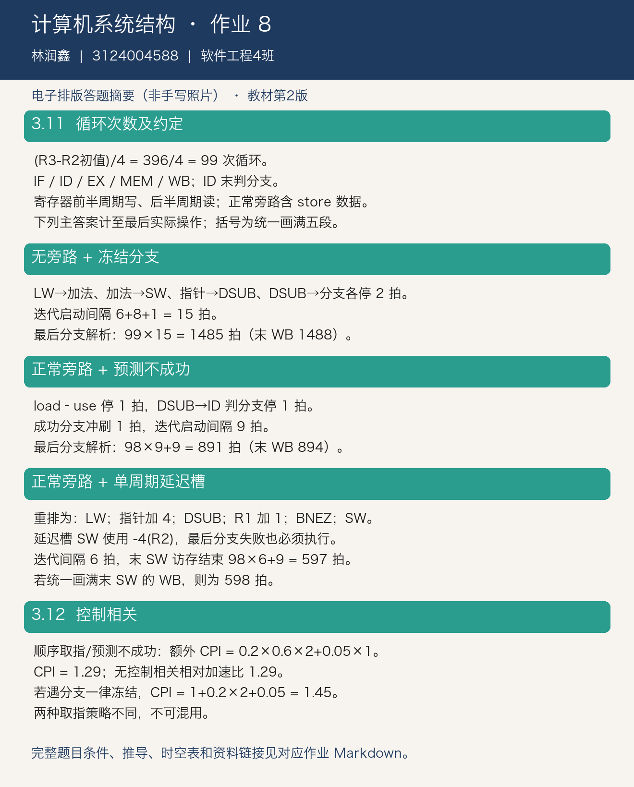

# 计算机系统结构 第八次作业

完成教材第三章最后两道题：习题 3.11（MIPS 循环调度）和习题 3.12（控制相关与加速比）。

## 作业信息

| | |
| -: | :- |
|科目|计算机系统结构|
|班级|软件工程4班|
|学号|3124004588|
|姓名|林润鑫|
|布置日期|2026-10-29|

> 教材口径：张晨曦等《计算机系统结构教程》第 2 版，清华大学出版社，ISBN 9787302360384。根据网上可读取的课本原页核对题号；课程说明本身未指定版次。本文为电子排版解答，非手写照片。

## 一、题目定位与流水线约定

第 2 版第三章习题结束于纸质页 93，最后两题为 **3.11、3.12**。这里明确采用教材介绍的经典五段及提前判分支的实现：

```text
IF（取指）→ ID（译码/读寄存器、判分支）→ EX（执行/地址计算）→ MEM（访存）→ WB（写回）
```

- 分离指令与数据存储器，不发生取指与数据访问的结构冲突；访存全部命中。
- 寄存器堆前半周期写、后半周期读，允许同周期读取刚写回的值。
- 分支在 ID 末解析；若有正常旁路，ALU 结果可由前一周期的 EX 末送给下一周期的 ID，不能让同周期尚未产生的 EX 结果供 ID 使用。
- 正常旁路包括 ALU 输入和 store 数据通路。相邻 load–use 仍有 1 个停顿。
- 表中 ID 的周期范围包含等待；等待会冻结后续取指。分支在 ID、store 在 MEM 已产生实际效果；它们的后续无操作段用括号标出。

题目没逐项重述分支判定级和 store 旁路通路，因此不同实现会出现不同周期数。以下把实现约定与每条指令的时空表一起列出，保证结果可复算。

## 二、习题 3.11：循环次数与依赖

```mips
LOOP:   LW      R1,0(R2)
        DADDIU  R1,R1,#1
        SW      R1,0(R2)
        DADDIU  R2,R2,#4
        DSUB    R4,R3,R2
        BNEZ    R4,LOOP
```

初始 $R3=R2+396$，每次循环 R2 加 4，故循环执行 $396/4=99$ 次，分支成功 98 次，最后一次不成功。

| 生产者→消费者 | 相关内容 |
| :--- | :--- |
| LW→DADDIU R1 | R1，load–use RAW |
| DADDIU R1→SW | R1，存储数据 RAW |
| DADDIU R2→DSUB | R2，RAW |
| DSUB→BNEZ | R4，分支条件 RAW |
| SW→下一迭代 LW | 地址必须先完成原元素的存储，再处理下一元素 |

### 2.1 无旁路，冻结分支

本题寄存器半周期读写可消除“写回同周期读”的额外等待，但没有旁路时仍须等到 WB。

| 指令 | IF | ID（含等待） | EX | MEM | WB |
| :--- | :--- | :--- | :--- | :--- | :--- |
| LW R1 | 1 | 2 | 3 | 4 | 5 |
| DADDIU R1 | 2 | 3–5 | 6 | 7 | 8 |
| SW R1 | 3–5 | 6–8 | 9 | 10 | (11) |
| DADDIU R2 | 6–8 | 9 | 10 | 11 | 12 |
| DSUB R4 | 9 | 10–12 | 13 | 14 | 15 |
| BNEZ R4 | 10–12 | 13–15 | (16) | (17) | (18) |
| 下一迭代 LW | **16** | 17 | 18 | 19 | 20 |

四组 RAW 各产生 2 拍等待，分支冻结另消耗 1 拍。迭代启动间隔为 $6+8+1=15$ 拍。

$$
T_{\text{最后分支解析}}=99\times15=\boxed{1485\text{ cycles}}
$$

若作图约定把末条分支也画满无操作的 EX/MEM/WB，则最后 WB 位置为 $98\times15+18=\boxed{1488}$。二者差别只是末尾无操作段的计数，不是多执行了指令。

### 2.2 正常旁路，预测分支不成功

LW→DADDIU 仍停顿 1 拍；DSUB→分支 ID 比较仍停顿 1 拍；其余所需数据可旁路。分支成功时清除一条顺序路径指令，下一循环从第 10 拍取指。

| 指令 | IF | ID（含等待） | EX | MEM | WB |
| :--- | :--- | :--- | :--- | :--- | :--- |
| LW R1 | 1 | 2 | 3 | 4 | 5 |
| DADDIU R1 | 2 | 3–4 | 5 | 6 | 7 |
| SW R1 | 3–4 | 5 | 6 | 7 | (8) |
| DADDIU R2 | 5 | 6 | 7 | 8 | 9 |
| DSUB R4 | 6 | 7 | 8 | 9 | 10 |
| BNEZ R4 | 7 | 8–9 | (10) | (11) | (12) |
| 下一迭代 LW（分支成功） | **10** | 11 | 12 | 13 | 14 |

成功迭代的启动间隔为 $6+1+1+1=9$ 拍；最后一次分支不成功，无需跳回，但条件仍在该迭代第 9 拍确定。

$$
T_{\text{最后分支解析}}=98\times9+9=\boxed{891\text{ cycles}}
$$

若统一画满末条分支的 WB，则为 $98\times9+12=\boxed{894}$。

### 2.3 正常旁路，单周期延迟分支，重排指令

将指针更新提前，DSUB 与 BNEZ 之间放入对 R1 的加法，使用 SW 填满延迟槽，并把存储偏移改为 -4，保持访问原地址。

```mips
LOOP:   LW      R1,0(R2)
        DADDIU  R2,R2,#4
        DSUB    R4,R3,R2
        DADDIU  R1,R1,#1
        BNEZ    R4,LOOP
        SW      R1,-4(R2)     # 延迟槽：分支成功与失败时均执行
```

| 指令 | IF | ID | EX | MEM | WB |
| :--- | ---: | ---: | ---: | ---: | ---: |
| LW R1 | 1 | 2 | 3 | 4 | 5 |
| DADDIU R2 | 2 | 3 | 4 | 5 | 6 |
| DSUB R4 | 3 | 4 | 5 | 6 | 7 |
| DADDIU R1 | 4 | 5 | 6 | 7 | 8 |
| BNEZ R4 | 5 | 6 | (7) | (8) | (9) |
| SW R1（延迟槽） | 6 | 7 | 8 | 9 | (10) |
| 下一迭代 LW | **7** | 8 | 9 | 10 | 11 |

各迭代可以每 6 拍启动，无需增加 NOP，也未增加指令条数。

$$
T_{\text{末次存储完成}}=98\times6+9=\boxed{597\text{ cycles}}
$$

若把末条 SW 也画满无操作 WB，则为 $98\times6+10=\boxed{598}$。

语义核对：每次 LW 读取旧指针所指元素，R1 加 1 后，SW 用新指针减 4 写回原元素。最后一次分支失败时延迟槽仍执行，故最后元素不会漏写。

### 2.4 周期数小结

| 实现（均在 ID 判分支） | 迭代启动间隔 | 最后实际操作完成 | 所有指令统一画满五段 |
| :--- | ---: | ---: | ---: |
| 无旁路 + 冻结分支 | 15 | 1485 | 1488 |
| 正常旁路 + 预测不成功 | 9 | 891 | 894 |
| 正常旁路 + 延迟槽重排 | 6 | 597 | 598 |

如果分支改在 EX 或 MEM 才解析，上表不能直接套用；若 store 没有数据旁路，也应重新插入停顿。这里给出的“正常旁路”包含前文明确列出的通路。

## 三、习题 3.12：控制相关造成的性能损失

题意：4 段流水线，条件分支占 20%（其中 60% 分支成功），跳转和调用占 5%。无条件分支第 2 段末解析、条件分支第 3 段末解析；所有指令都经过独立的第 1 段。求无控制相关相对于有控制相关时的加速比。

### 3.1 预测不成功（顺序取指）的口径

采用顺序取指，条件分支不成功时没有清空损失；成功时第 3 段才确定，要清除 2 条错误路径指令，损失 2 拍。无条件跳转/调用第 2 段末才确定，损失 1 拍。

$$
CPI_{control}=1+0.20\times0.60\times2+0.05\times1=1.29
$$

$$
S=\frac{T_{\text{有控制相关}}}{T_{\text{无控制相关}}}=\frac{1.29}{1}=\boxed{1.29}
$$

答案：长指令流下，无控制相关的流水线性能是有控制相关时的 **1.29 倍**，提高 29%；消除控制相关使执行时间减少 $1-1/1.29\approx22.48\%$。

保留 4 段流水线的建立开销、处理 $n$ 条实际指令时：

$$
S_n=\frac{n+3+0.29n}{n+3}\longrightarrow1.29
$$

### 3.2 冻结到分支解析的另一口径

若遇到条件分支后无论成功与否都冻结取指，则所有条件分支均损失 2 拍，60% 的成功率不再影响等待时间：

$$
CPI=1+0.20\times2+0.05\times1=1.45,\qquad S\approx1.45
$$

题目未直接写出取指策略，主答案采用利用 60% 成功率的顺序取指/预测不成功口径，同时列出冻结策略，防止把两个模型混算。

## 四、电子答题稿



教材题目核对：[第 2 版课本](https://github.com/gushouchuanzhi1/2024_hust_ComputerSystemArchitecture/blob/main/计算机系统结构教程课本.pdf)，纸质页 92–93。
